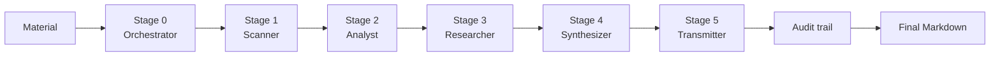

# Architecture

Vishap is a FastAPI service backed by a 6-stage LLM pipeline, an optional Celery/Redis queue, PostgreSQL for job persistence, and Clerk for auth.

## Components

| Component | Responsibility |
|---|---|
| `src/main.py` | FastAPI app: sync/async analysis, webhooks, metrics |
| `src/pipeline/orchestrator.py` | 6-stage pipeline (Stage 0..5), audit trail |
| `src/pipeline/stages.py` | Per-stage prompt builders and LLM calls |
| `src/llm/` | DSH harness client (the only LLM provider) |
| `src/api/` | JobStore (memory/Postgres) + Celery tasks |
| `src/auth/` | Clerk JWT verification (JWKS) |
| `src/github_app/` | GitHub App: JWT, PR comment, webhook |
| `src/observability/` | structlog logging + Prometheus metrics |
| `src/tools/` | Deterministic tools (SAST, SCA, SARIF, SBOM, ...) |

## Dataflow

Stages 0, 1, 2 and 4 run for every request; Stage 3 runs only when the material needs external research. Deterministic tools (SAST/SCA, SARIF, SBOM, compliance) enrich the audit trail around the LLM stages.

## Security

- **PII redaction** — secrets and PII are redacted before any LLM call. The audit trail records both `material_hash` (analyzed slice) and `material_hash_full` (original).
- **Fernet** — secret encryption via `src/security/fernet.py` (`FERNET_KEY` env).
- **HMAC** — GitHub webhooks are verified with `X-Hub-Signature-256`.
- **JWT** — Clerk verifies RS256 tokens against JWKS; the GitHub App signs requests with an RS256 JWT.

## Observability

- **structlog** — pretty in dev, JSON in prod (`LOG_FORMAT`), request/job-scoped contextvars.
- **Prometheus** — `GET /metrics` exposes job counters, job duration histogram, HTTP request counters, and LLM token counters.
- **Audit trail** — every result carries an audit record (hashes, verdicts, compliance flags, provenance).
